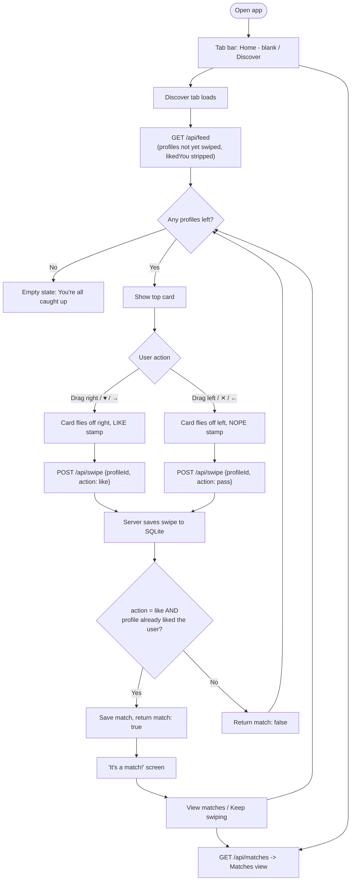
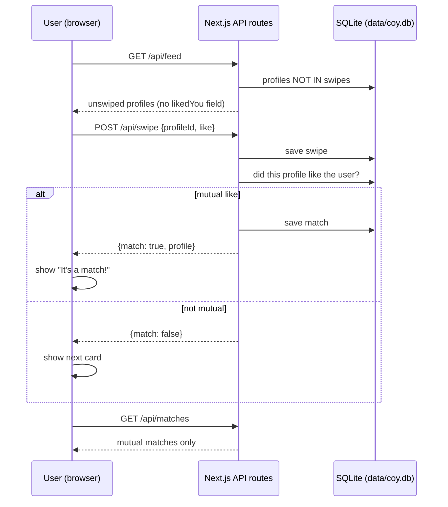

# Coy – Discover tab

A swipe-based discovery feature (Tinder/Bumble style) built as a standalone Next.js app.
The app has a bottom tab bar with a blank **Home** placeholder and the working **Discover** tab.

**Stack:** Next.js (App Router) + React, API routes for the backend, **SQLite** (`better-sqlite3`) for storage. No external auth: a single logged-in user is assumed.

## Run it

```bash
npm install
npm run dev        # http://localhost:3000  (open in a phone-sized window for the mobile layout)
```

Production: `npm run build && npm start`.

## Features

| Requirement | How it's done |
|---|---|
| 32 seeded profiles | `data/seed.json` (name, age, photo, bio, city/college, interests) |
| Some already like you | 10 profiles have `likedYou: true` in the seed (ids 2, 5, 8, 11, 14, 17, 20, 23, 26, 29) |
| Swipe gestures | Pointer-event drag (touch + mouse) with rotation, LIKE/NOPE stamps, fly-off animation, spring-back below the threshold |
| Buttons / keyboard | ✕ and ♥ buttons, plus ← / → arrow keys on desktop |
| Never see a profile twice | Every swipe is saved server-side; `/api/feed` filters out anything already swiped |
| Empty state | "You're all caught up" screen (with a *Reset demo data* button) |
| Match screen | Full-screen **"It's a match!"** overlay, shown only on a mutual like |
| Matches view | **Matches** toggle inside the Discover tab, with a count badge |
| Persistence | Swipes and matches are stored in the SQLite file `data/coy.db` and survive reloads and server restarts |

## The privacy promise

The `profiles` table has a private `liked_user` column. It is **never sent to the client**: the queries in `lib/db.js` select only the public columns, and the swipe handler strips it before returning a matched profile. The only way the UI learns that someone liked you is the `match: true` response to *your own* like, i.e. when it is already mutual. Passing on someone who liked you reveals nothing.

## API

| Method | Path | Description |
|---|---|---|
| GET | `/api/feed` | Profiles not yet swiped on. Response: `{ profiles: [...] }` |
| POST | `/api/swipe` | Body `{ "profileId": 2, "action": "like" \| "pass" }`. Response: `{ match: boolean, profile? }`. Repeat swipes on the same profile are ignored (`alreadySwiped: true`). 400 on a bad action, 404 on an unknown profile. |
| GET | `/api/matches` | Mutual matches only, newest first: `{ matches: [...] }` |
| POST | `/api/reset` | Demo helper: clears all swipes and matches |

## Flow diagram



### Match sequence



## Database schema

```sql
profiles(id PK, name, age, photo, bio, location, interests JSON, liked_user)  -- liked_user is private
swipes(profile_id PK -> profiles.id, action 'like'|'pass', created_at)
matches(profile_id PK -> profiles.id, created_at)
```

## Project structure

```
app/
  page.js              tab bar (Home placeholder + Discover)
  layout.js, globals.css
  api/feed|swipe|matches|reset/route.js
components/
  Discover.js          deck, feed loading, swipe handling, empty state
  SwipeCard.js         drag gestures + animation
  MatchModal.js        "It's a match!" screen
  Matches.js           matches list
lib/db.js              SQLite schema, auto-seeding, feed / swipe / matches queries
data/seed.json         32 mock profiles (loaded into SQLite on first run)
data/coy.db            created automatically (git-ignored)
```

## Notes / trade-offs

- The database is created and seeded automatically on first request. To start completely fresh, stop the server and delete `data/coy.db*` (or use the *Reset demo data* button, which clears swipes and matches).
- Swipes are transactional: `swipes.profile_id` is the primary key, so a profile can never be swiped twice even under concurrent requests, and a match is created in the same transaction as the like.
- To move to a hosted database (Postgres, Supabase, etc.) only `lib/db.js` needs to change; the routes and UI stay the same.
- Photos come from randomuser.me placeholder portraits; if they fail to load, the card falls back to a gradient.
- If a swipe fails to save (e.g. network drop), the card is put back on top so the swipe isn't lost.
